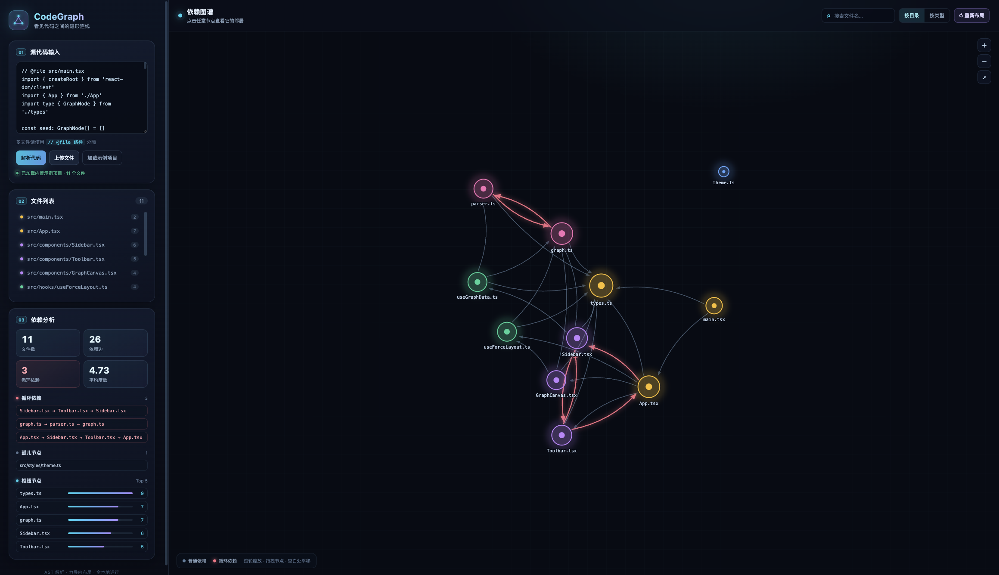

<div align="center">

[English](README.md) | [中文](README-zh.md)

# 🕸️ CodeGraph

**把任意 TypeScript 或 JavaScript 代码库变成一张可交互的依赖图谱 —— 就在你的浏览器里。**

面向需要看清代码连接关系的开发者：粘贴源码，立刻得到一张会动的图谱，几秒内发现循环依赖、孤儿文件与隐藏的枢纽节点。

[](https://github.com/webxiongda/codegraph)
[](./LICENSE)
[](https://github.com/webxiongda/codegraph/issues)
[](https://react.dev/)
[](https://www.typescriptlang.org/)

</div>

<div align="center">
  
</div>

## 为什么需要 CodeGraph？

每一个不断长大的代码库，都会悄悄积累出你已经看不清的结构。import 链在目录之间蜿蜒，模块互相循环调用，少数文件变成负载过重的枢纽，另一些则沦为无人问津的孤儿。一次只读一个文件，这些结构是看不出来的；等到某个环真正引发 bug，它往往早已扩散开来。

应对这个问题的多数方案，要么要求你安装一个服务，要么把代码上传到别人的服务器。CodeGraph 走了另一条路：**一切都在你的浏览器本地完成**。源码由真正的 TypeScript 编译器解析，而不是正则近似匹配，并且永远不会离开你的电脑。你得到的不是一张静态示意图，而是一张可以拖拽、缩放、逐一追问的活图谱。

这种需求早已被验证。[graphify](https://github.com/sickgyun/graphify)（10.6k+ stars）、[dependency-cruiser](https://github.com/sverweij/dependency-cruiser) 和 [madge](https://github.com/pahen/madge) 都表明，开发者确实渴望**看见**自己的架构并找出环。CodeGraph 把这种能力带进一个零后端、单页面的工具里，配以手写布局和零图表库。

## 特性

| 特性 | 说明 |
| --- | --- |
| 真实 AST 解析 | 通过 `ts.createSourceFile` 提取静态 import、re-export、动态 `import()`、`require()` 与 type-only 引用，支持 `.ts`、`.tsx`、`.js`、`.jsx`。 |
| 三种输入方式 | 粘贴带 `// @file path` 标记的多文件文本、上传本地文件，或一键加载内置 11 文件示例项目。 |
| 手写力导向布局 | 斥力、弹簧引力、向心力与阻尼通过 `requestAnimationFrame` 逐帧迭代；节点大小按度数缩放。 |
| 可交互图谱 | 拖拽节点、滚轮缩放、平移画布；点击节点高亮一跳邻居并淡出其余节点。 |
| 环检测 | DFS 三色标记枚举所有有向环，并高亮每个环上的边。 |
| 孤儿与枢纽 | 找出孤立文件，并对高度连接的枢纽文件排名，让你看清耦合集中在哪里。 |
| 结构指标 | 文件数、依赖边数、环数、平均度数、连通分量，以及以内联 SVG 绘制的度数分布图。 |
| 灵活着色 | 按目录或文件类型为节点着色，按文件名搜索即可聚焦某个文件及其直接邻居。 |
| 零后端、零图表库 | 运行时只有 React 与 TypeScript；图谱与发光效果全部是内联 SVG 加原生 CSS。 |
| 本地持久化 | 设置、解析历史与保存的项目存放于 `localStorage`，存储不可用时安全降级为内存状态。 |

## 快速开始

```bash
git clone https://github.com/webxiongda/codegraph.git
cd codegraph && npm install
npm run dev
```

打开终端提示的地址（默认 `http://localhost:5173`）。内置示例会自动加载 —— 11 个文件、26 条依赖边、3 个循环依赖 —— 所以在你粘贴任何一行代码之前，就已经有一张图谱可以探索。测试运行 `npm test`。

## 页面

CodeGraph 使用 hash 路由，因此每个视图都是一个可分享的 URL，并且能在 iframe 中正常工作。

| Hash | 页面 | 作用 |
| --- | --- | --- |
| `#/graph` | 图谱工作台 | 拖拽、缩放并聚焦依赖图谱。 |
| `#/projects` | 项目库 | 加载内置示例与本地保存的项目。 |
| `#/files` | 文件浏览器 | 按目录查看每个文件的连接度。 |
| `#/cycles` | 循环依赖 | 找出环并给出拆解建议。 |
| `#/orphans` | 孤儿与枢纽 | 对孤立文件与高连接枢纽文件排名。 |
| `#/input` | 代码输入 | 粘贴源码文本或上传整个目录。 |
| `#/metrics` | 指标面板 | 用图表与迷你折线图读懂项目结构。 |
| `#/guide` | 使用指南 | 四步上手流程及其背后的 AST 原理。 |
| `#/about` | 关于与热点 | 灵感来源、社区信号、技术栈与许可。 |
| `#/settings` | 设置 | 调整图谱外观并持久化偏好。 |

## 工作原理

每个文件都由 TypeScript Compiler API（`ts.createSourceFile`）编译成 AST；工具遍历 `ImportDeclaration`、`ExportDeclaration`、动态 `import()` 与 `require()` 调用以及 `ImportTypeNode` 来收集内部依赖。裸模块名（bare module specifier）会被排除，让图谱聚焦于你自己的代码；相对路径则被规范化，并对已知文件集合进行解析。结果是一个由节点和边组成的 `GraphModel`。`findCycles` 用 DFS 三色标记枚举有向环，`GraphCanvas` 在每一帧推进力导向模拟 —— 斥力、弹簧引力、向心力与阻尼 —— 并把结果渲染成带发光效果的内联 SVG。设置、历史与项目通过一个带保护的 `localStorage` 层持久化，在存储不可用时优雅降级。

## 技术栈

- **React 18** —— 界面与状态
- **TypeScript 5.6** —— 类型与编译器 API
- **Vite 6** —— 开发服务器与构建
- **零额外依赖** —— 没有图表库、UI 框架或状态管理；只有 hash 路由、内联 SVG 与原生 CSS

## 文档

- [English README](./README.md)
- [贡献指南 (Contributing)](./CONTRIBUTING.md)
- [许可协议 (License)](./LICENSE)

## 贡献

欢迎贡献。无论是修复解析器的边界情况、调整力导向布局、新增指标，还是翻译文档，都可以开 issue 或提交 PR —— 从 `good first issue` 入手即可。高价值方向包括：更广的语法覆盖（新的 `EdgeKind` 情况）、更智能的拆解环建议、更多结构指标，以及布局与着色选项。

## 路线图

- [ ] 支持路径别名与基于 `tsconfig.json` 的解析
- [ ] 支持将图谱导出为 SVG 与 PNG 快照
- [ ] 增加 diff 视图，对比两个版本之间的依赖图谱
- [ ] 扩展拆解环建议，给出具体的重构步骤
- [ ] 增加可选的多语言界面翻译

## 许可

[MIT](./LICENSE) © 2026 CodeGraph contributors。
