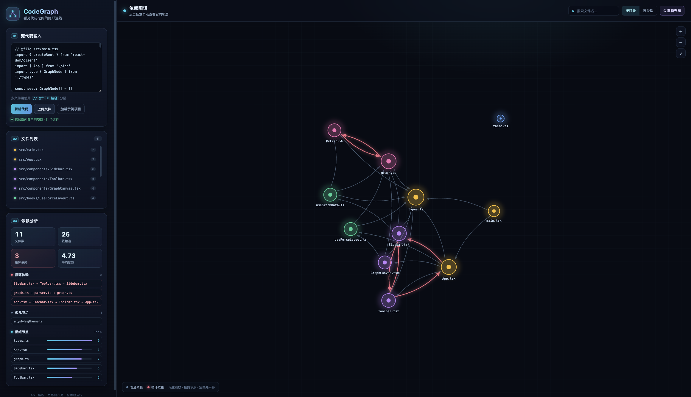

<div align="center">

[English](README.md) | [中文](README-zh.md)

# 🕸️ CodeGraph — TypeScript / JavaScript Dependency Graph

▶ **[Try it live](https://webxiongda.github.io/codegraph/)** — no install, runs in your browser.

**Turn any TypeScript or JavaScript codebase into an interactive dependency graph — right in your browser.**

For developers who need to see how their code connects: paste your source, get a live graph, and spot circular dependencies, orphan files, and hidden hubs in seconds.

[](https://github.com/webxiongda/codegraph)
[](./LICENSE)
[](https://github.com/webxiongda/codegraph/issues)
[](https://react.dev/)
[](https://www.typescriptlang.org/)

</div>

<div align="center">
  
</div>

## Why CodeGraph?

Every growing codebase quietly accumulates structure you can no longer see. Import chains snake across folders, modules call each other in circles, a handful of files become overloaded hubs, and others rot away as orphans. None of this is obvious from reading one file at a time, and by the time a cycle causes a real bug it has usually spread.

Most answers to this problem ask you to install a service or upload your code to someone else's server. CodeGraph takes a different route: **everything happens locally in your browser**. Your source is parsed with the real TypeScript compiler, never a regex approximation, and it never leaves your machine. What you get is not a static diagram but a living graph you can drag, zoom, and interrogate.

The appetite for this is well established. Projects like [graphify](https://github.com/sickgyun/graphify) (10.6k+ stars), [dependency-cruiser](https://github.com/sverweij/dependency-cruiser), and [madge](https://github.com/pahen/madge) all show that developers actively want to *see* their architecture and find cycles. CodeGraph brings that capability into a zero-backend, single-page tool with a hand-written layout and no charting library.

## Features

| Feature | Description |
| --- | --- |
| Real AST parsing | `ts.createSourceFile` extracts static imports, re-exports, dynamic `import()`, `require()`, and type-only references across `.ts`, `.tsx`, `.js`, and `.jsx`. |
| Three input modes | Paste multi-file text with `// @file path` markers, upload local files, or load the built-in 11-file sample project in one click. |
| Hand-written force layout | Repulsion, spring attraction, center pull, and damping run per frame via `requestAnimationFrame`; node size scales with degree. |
| Interactive graph | Drag nodes, scroll to zoom, pan the canvas, and click a node to highlight its one-hop neighbors while fading the rest. |
| Cycle detection | DFS three-color marking enumerates every directed cycle and highlights the edges on each cycle. |
| Orphans & hubs | Surface isolated files and rank the top-degree hub files so you know where coupling concentrates. |
| Structure metrics | Files, edges, cycles, average degree, connected components, and a degree distribution rendered as inline SVG charts. |
| Flexible coloring | Color nodes by directory or file kind, and search by filename to focus a file and its direct neighbors. |
| Zero backend, zero chart library | Only React and TypeScript at runtime; the graph and its glow effects are pure inline SVG plus CSS. |
| Local persistence | Settings, parse history, and saved projects live in `localStorage` with a safe in-memory fallback. |

**🔗 Live demo:** https://webxiongda.github.io/codegraph/

## Quick Start

```bash
git clone https://github.com/webxiongda/codegraph.git
cd codegraph && npm install
npm run dev
```

Open the address printed in your terminal (by default `http://localhost:5173`). The built-in sample loads automatically — 11 files, 26 edges, and 3 circular dependencies — so there is a graph to explore before you paste a single line. Run the test suite with `npm test`.

## Pages

CodeGraph uses a hash router, so every view is a shareable URL and works inside an iframe.

| Hash | Page | What it does |
| --- | --- | --- |
| `#/graph` | Graph Workbench | Drag, zoom, and focus the dependency graph. |
| `#/projects` | Project Library | Load built-in samples and locally saved projects. |
| `#/files` | File Browser | Browse each file's connectivity, grouped by directory. |
| `#/cycles` | Circular Dependencies | Find cycles and get suggestions for breaking them. |
| `#/orphans` | Orphans & Hubs | Rank isolated files and highly connected hub files. |
| `#/input` | Code Input | Paste source text or upload a whole directory. |
| `#/metrics` | Metrics Dashboard | Read project structure through charts and sparklines. |
| `#/guide` | Usage Guide | A four-step walkthrough and the AST principles behind it. |
| `#/about` | About & Signals | Inspiration, community signals, tech stack, and licensing. |
| `#/settings` | Settings | Tune graph appearance and persist your preferences. |

## How it works

Each file is compiled with the TypeScript Compiler API (`ts.createSourceFile`) into an AST; the tool walks `ImportDeclaration`, `ExportDeclaration`, dynamic `import()` and `require()` calls, and `ImportTypeNode` to collect internal dependencies. Bare module specifiers are excluded so the graph stays focused on your own code, while relative paths are normalized and resolved against the set of known files. The result is a `GraphModel` of nodes and edges. `findCycles` runs DFS three-color marking to enumerate directed cycles, and `GraphCanvas` advances a force simulation — repulsion, spring attraction, center pull, and damping — on every animation frame, rendering the result as glow-styled inline SVG. Settings, history, and projects are persisted through a guarded `localStorage` layer that degrades gracefully when storage is unavailable.

## Tech Stack

- **React 18** — UI and state
- **TypeScript 5.6** — types and the compiler API
- **Vite 6** — dev server and build
- **Zero extra dependencies** — no chart library, UI framework, or state manager; hash router, inline SVG, and native CSS only

## Documentation

- [中文文档 (Chinese README)](./README-zh.md)
- [Contributing guide](./CONTRIBUTING.md)
- [License](./LICENSE)

## Contributing

Contributions are welcome. Whether you are fixing a parser edge case, tuning the force layout, adding a metric, or translating docs, open an issue or pull request — look for `good first issue` to get started. High-value directions include broader syntax coverage (new `EdgeKind` cases), smarter cycle-breaking suggestions, additional structure metrics, and layout/coloring options.

## Roadmap

- [ ] Support path aliases and `tsconfig.json`-based resolution
- [ ] Export graphs as SVG and PNG snapshots
- [ ] Add diff view to compare dependency graphs between two revisions
- [ ] Expand cycle-breaking suggestions with concrete refactor steps
- [ ] Add optional multi-language UI translations

## License

[MIT](./LICENSE) © 2026 CodeGraph contributors.
